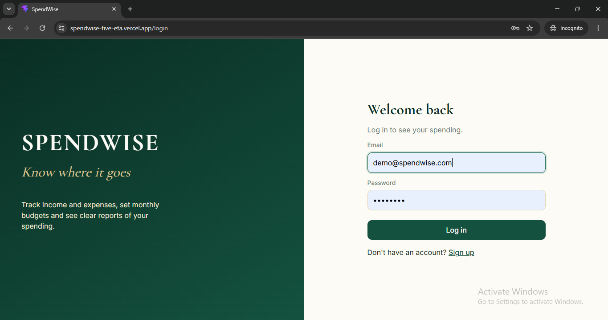
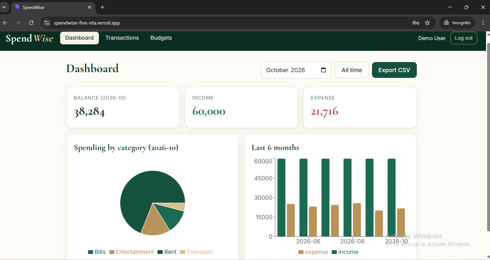
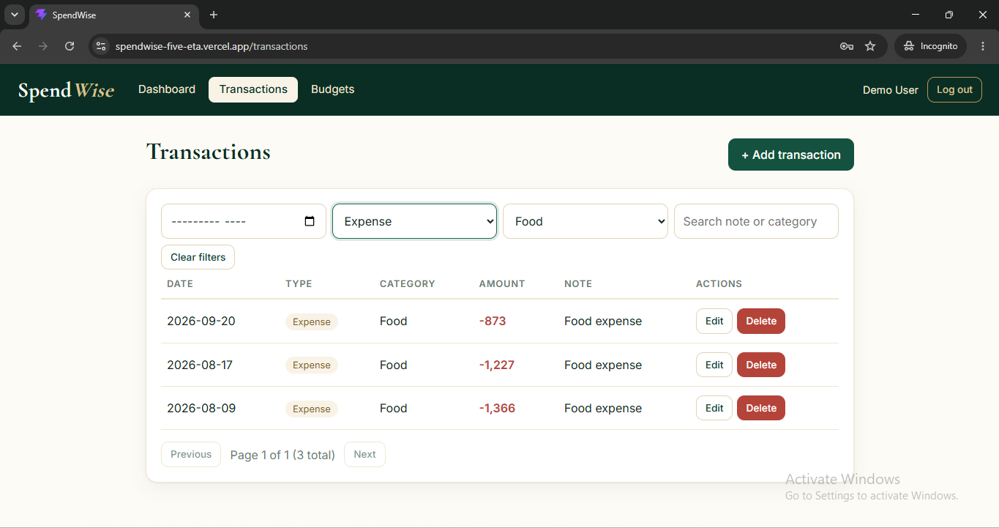
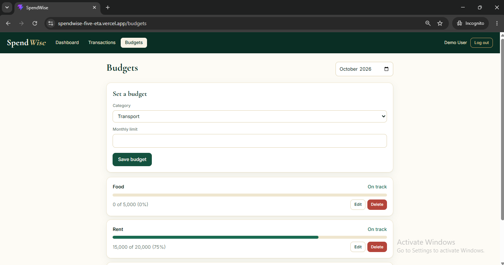
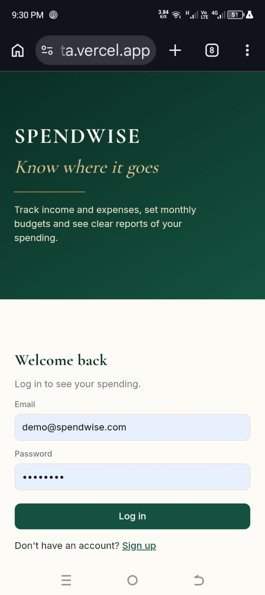
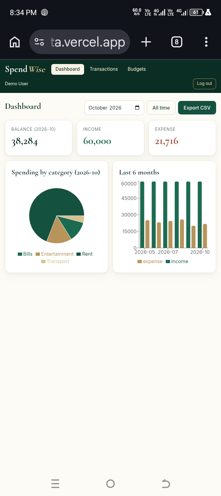
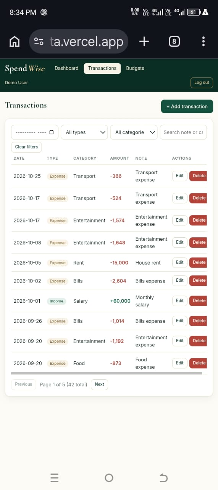
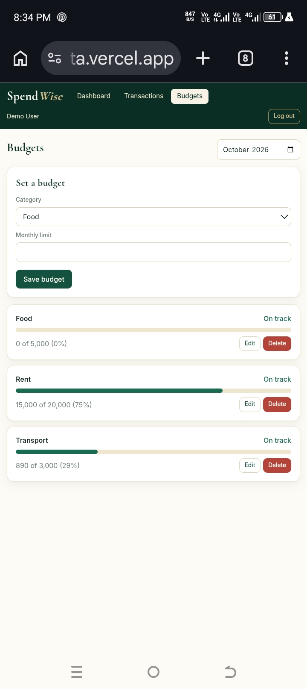

# SpendWise: Personal Finance & Expense Tracker

A full-stack MERN application that helps students and young professionals understand where their money goes each month. Users can track income and expenses, set monthly budgets per category, and view clear spending reports on a visual dashboard.

**Live Demo:** https://spendwise-five-eta.vercel.app<br>
**GitHub:** https://github.com/SanaZehra062/spendwise<br>

## Demo Login

| Email | Password |
|---|---|
| demo@spendwise.com | Demo1234 |

## Features

### User
- Sign up, log in, log out, and stay logged in after refresh
- Add, edit and delete income and expense transactions
- Filter by month, category and type
- Search transactions with paginated results
- Set a monthly budget per category with a warning at 80% usage
- Dashboard with balance, income vs. expense, spending by category (pie chart) and last 6 months (bar chart)
- Export transactions to CSV
- Responsive design for desktop and mobile

### Security and Quality
- Passwords hashed with bcrypt
- JWT authentication, every API route except auth is protected
- Validation with Zod on both client and server
- Totals and charts calculated with MongoDB aggregation

## Tech Stack

- **Frontend:** React (Vite), React Router v6, React Hook Form, Zod, Axios, Recharts, CSS
- **Backend:** Node.js, Express, Mongoose, Zod, bcrypt, JSON Web Tokens
- **Database:** MongoDB Atlas
- **Deployment:** Vercel
- **Version Control:** Git & GitHub

## Project Structure

```
spendwise/
│── client/          React frontend
│── server/          Express API
│── postman/         Postman collection
│── docs/
│   └── screenshots/
└── README.md
```

## Getting Started

### Prerequisites

- Node.js 18+
- npm
- Git
- A MongoDB Atlas connection string

### Installation

**1. Clone the repository**

```bash
git clone https://github.com/SanaZehra062/spendwise.git
cd spendwise
```

**2. Set up the server**

```bash
cd server
npm install
```

Create a file `server/.env`:

```
MONGO_URI=your_mongodb_connection_string
JWT_SECRET=your_secret_key
CLIENT_URL=http://localhost:5173
```

Start the server:

```bash
npm run dev
```

**3. Set up the client** (in a second terminal)

```bash
cd client
npm install --legacy-peer-deps
```

Create a file `client/.env`:

```
VITE_API_URL=http://localhost:5000/api
```

Start the client:

```bash
npm run dev
```

**4. Open in your browser**

```
http://localhost:5173
```

### Seed Sample Data (optional)

Sign up in the app first, then run this from the `server/` folder:

```bash
node scripts/seed.js your@email.com reset
```

## Screenshots

### Desktop

| Login | Dashboard |
|---|---|
|  |  |

| Transactions | Budgets |
|---|---|
|  |  |

### Mobile

| Login | Dashboard | Transactions | Budgets |
|---|---|---|---|
|  |  |  |  |

## API Overview

All routes start with `/api`. Every route except auth requires an `Authorization: Bearer <token>` header.

| Area | Endpoints |
|---|---|
| Auth | `POST /auth/register`, `POST /auth/login`, `GET /auth/me` |
| Transactions | `GET /transactions`, `POST /transactions`, `GET/PATCH/DELETE /transactions/:id` |
| Budgets | `GET /budgets`, `POST /budgets`, `PATCH/DELETE /budgets/:id` |
| Reports | `GET /reports/summary`, `/reports/by-category`, `/reports/monthly`, `/reports/export` |

A Postman collection is available in the `postman/` folder.

## Learning Outcomes

- Secure authentication with JWT and bcrypt
- Building CRUD REST APIs with Express and Mongoose
- Filtering, search and pagination with query parameters
- MongoDB aggregation (`$match`, `$group`) for reports
- React Router protected routes and auth context
- Form handling and validation with React Hook Form and Zod
- Data visualization with Recharts
- Deploying a full-stack app on Vercel

## Future Enhancements

- Forgot password with an email reset link
- Change password and update profile from inside the app
- Recurring transactions (for example, monthly rent) added automatically
- Multi-currency support
- Automatic refresh of budget warnings after every change
- Email alerts when a budget limit is crossed

  
## Author

Sana Zehra

GitHub: https://github.com/SanaZehra062